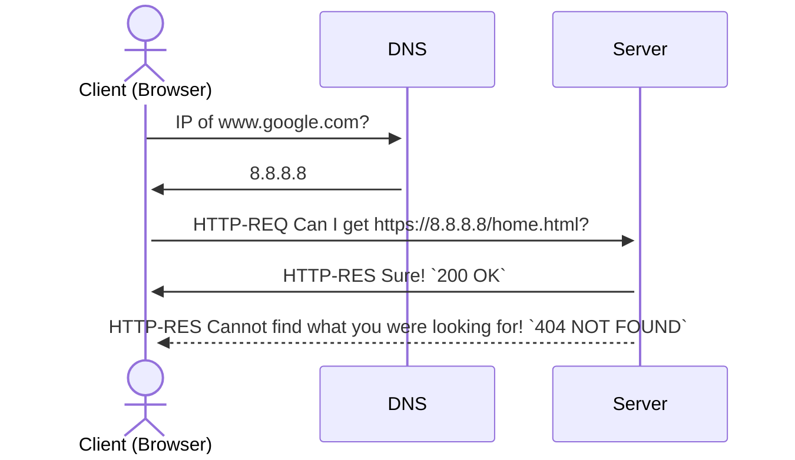

+++

title = "Web Intro - HTML, CSS, JS"
description = "Introduzione alla programmazione Web"
outputs = ["Reveal"]
aliases = [
    "/guide/"
]

+++

##### Istituto Tecnico Economico "Giovanni Agnelli" **@** Cesenatico
{}
# Introduzione al **Web**
{}

## I web standard: **HTML**, **CSS**, **JavaScript**

<small>

A cura di Nicholas Magi

`nicholasmagi[at]davincicesenatico.it`

</small>

<br>

<br>
{}

---
{}

#### Parte **#01**.
# **Il Web**
## Definizione, architettura, interazioni.

---

<br>
<br>
<br>
    
## Il Web

{{% callout type="cite" src="[Enciclopedia Treccani]" srcLink="https://www.treccani.it/enciclopedia/web_%28Enciclopedia-Italiana%29/" %}}
Il **web** (abbreviazione di *world wide web*, 'ragnatela mondiale', spesso indicato brevemente anche come www) è un sistema di **interconnessione tra documenti** basato sull'infrastruttura di Internet che permette l'accesso a tutta l'informazione disponibile su computer collegati in rete.
{}

---

### Sul **web** possono essere disponibili <br> **qualsiasi tipo di documenti**.

Immagini, video, audio, documenti Word, PDF...

---

## Come **interagiamo** con il **web**?

{}
**browser** $\neq$ **motore di ricerca**!
{}

{}
{}

### Browser

> "**Programma** - software - installabile su un dispositivo che si **interfaccia con il web** e permette di **visualizzare ciò che cerchi**."

<br>

- esempio: Google Chrome, Apple Safari, Microsoft Edge, Mozilla Firefox, Brave, Opera, **Tor Browser**...
{}
{}

### Motore di ricerca

> "**Servizio** fruibile da browser che permette, mediante **parole chiave** e strumenti specializzati, di cercare risorse sul web."

<br>

- esempio: Google, DuckDuckGo, Yahoo, Bing...

{}
{}


---

### Architettura **Client-Server** 

{}
{}
#### In generale

{}
{}
#### In particolare

{}
{}

---

### Cosa succede quando si fa una richiesta sul web? / 1


<small>

Da *MDN Web Docs, Populating the page: how browsers work* - https://developer.mozilla.org/en-US/docs/Web/Performance/Guides/How_browsers_work

</small>

---

### Cosa succede quando si fa una richiesta sul web? / 2



---

### **Approfondimento**: operatori di ricerca e Google Dorking / 1

Quando interrogo un motore di ricerca, posso utilizzare determinate **parole chiave** per filtrare i risultati/vincolare il motore di ricerca stesso.

Qualche esempio:

<div class="bg-white rounded rounded-lg shadow-sm border border-4 p-2">

| Operatore            | Utilizzo                                                                                                         | Esempio - da digitare sulla barra di ricerca del browser |
|----------------------|------------------------------------------------------------------------------------------------------------------|----------------------------------------------------------|
| `filetype:pdf`       | Filtra solo i file di tipo `pdf` (*posso cercare qualunque estensione*).                                         | `HTML Cheatsheet filetype:pdf`                           |
| `site:repubblica.it` | Filtra solo i risultati provenienti dal sito `repubblica.it` (*posso sostituire con qualunque URL*).             | `Tecnologia site:repubblica.it`                          |
| `inurl:admin`        | Filtra solo le pagine in cui la parola "*admin*" è presente nell'URL. (*posso sostituire con qualunque parola*). | `portaleargo.it inurl:areautenti`                        |

</div>

---

### **Approfondimento**: operatori di ricerca e Google Dorking / 2

Tanti altri operatori!

Combinazioni "notevoli" di più operatori raccolte nel **GHDB** (*Google Hacking Database*).


> Visita il sito: https://www.exploit-db.com/google-hacking-database

{}

---

{}

#### Parte **#02**.
# **Web Standards**
## Introduzione agli strumenti del web, il DOM.

---

## Web standards

- Tecnologie utilizzate per costruire **siti web**.

### Princìpi chiave

1. Libera contribuzione e utilizzo
2. Accessibilità
3. Retrocompatibilità

---


<small>**Disclaimer**: Immagine generata da Intelligenza Artificiale - Google Gemini.</small>

{}
{}

## HTML
**Struttura** di un documento.
- "**Com'è fatta** una pagina."

{}
{}

## CSS
**Presentazione** di un documento.
- "**Come si presenta** una pagina."

{}
{}

## JavaScript
**Interattività** di un documento.
- "**Quali funzionalità** ha una pagina."

{}
{}

---

## Come funziona un **browser**?

Il browser, oltre a gestire le *request/response HTTP*, è un **convertitore di documenti HTML**.

<br>

> È in grado di **capire** la sintassi di HTML e di **mostrare** (*to render*) a finestra il contenuto visuale di un documento.

---

## **D**ocument **O**bject **M**odel (**DOM**)

Oggetto costruito nella memoria del browser che rappresenta, sotto forma di un **albero**, la **struttura** di un documento HTML.

<iframe src="https://didattica-nm.github.io/dom-visualizer/" class="w-100" height="750">
    
</iframe>

<small>Link allo strumento: https://didattica-nm.github.io/dom-visualizer/ (fork di **`@0xedward`**) || <a href="files/sample.html.txt" target="_blank">Codice HTML di esempio da incollare</a> || <a href="files/sample.html" target="_blank">Render finale</a> </small>

---

## Dal **codice** al **sito**.


<br>

<small>Da *MDN Docs, How browsers load websites* - https://developer.mozilla.org/en-US/docs/Learn_web_development/Getting_started/Web_standards/How_browsers_load_websites</small>

{}

---

{}

#### Parte **#03**.
# **HTML**
## Tag e loro semantica, attributi, esempi vari.

---


<br>

## **HTML**
### **H**yperText **M**arkup **L**anguage

---

### Linguaggio di markup
- come $\LaTeX{}$, markdown, XML...
- definisce la *struttura* e il *contenuto* di una pagina

<br>
<br>

{} 
**Non è un linguaggio di programmazione**!
{}

---


---

## HTML: **Tag**

{}
{}
- Una pagina si compone di un insieme di **tag**:
  - ogni tag è composto da un **nome** (*case insensitive*) circondato da `<` e `>`;
  - per ogni tag possono essere specificati alcuni attributi coppia `nome="valore"` che specifica alcune proprietà dell’elemento
{}
{}


{}
{}

---

{}
{}

### Codice sorgente

```html { linenos=inline hl_lines=["4", "20"] }
<!DOCTYPE html> 
<!-- Dichiaro il tipo di documento -->

<html>
  <!-- Parte di metadati della pagina -->
  <head>
    <title>Il mio bellissimo sito</title>
  </head>

  <!-- Contenuto della pagina -->
  <body>
    <h1 style="text-align: center">My ToDo List</h1>
    <ul>
      <li>Fai i compiti</li>
      <li>Gioca a Call Of Duty</li>
      <li>Vai in palestra</li>
    </ul>
    <a href="www.google.com">Cerca su Google</a>
  </body>
</html>
```
{}
In evidenza il tag `<html>`, **radice** della pagina.
{}

{}
{}

### Render

<iframe class="w-100 rounded shadow-lg h-100" style="border: 5px solid black" 
  sandbox
  src='about:blank'
  srcdoc="<!DOCTYPE html> 
<!-- Dichiaro il tipo di documento -->

<html>
    <!-- Parte di metadati della pagina -->
    <head>
      <title>Il mio bellissimo sito</title>
    </head>

    <!-- Contenuto della pagina -->
    <body>
      <h1 style="text-align: center">My ToDo List</h1>
      <ul>
        <li>Fai i compiti</li>
        <li>Gioca a Call Of Duty</li>
        <li>Vai in palestra</li>
      </ul>
      <a href="www.google.com">Cerca su Google</a>
    </body>
</html>">
</iframe>
{}

{}

---

## Semantica dei tag


Ogni tag deve essere usato in accordo con il **contenuto che deve rappresentare**.

---

## Suddivisione in categorie
<br>

{}
{}
Di tag ce ne sono tanti, e possiamo dividerli in categorie in base al **tipo di contenuto** che rappresentano (un paragrafo? un audio? una lista?).

<br>

{}
*Non ci interessa impararli tutti a memoria!* Dobbiamo diventare abili nel **consultare la documentazione**.
{}

<br>

Guide di riferimento: 
- [Mozilla Developer Network - MDN Docs](https://developer.mozilla.org/en-US/docs/Web/HTML)
- [W3Schools](https://w3schools.com/html)

{}
{}
1. **Basic HTML**
2. Formatting
3. Forms and Input
4. Iframe
5. **Images**
6. Audio/Video
7. **Links**
8. **Lists**
9. Tables
10. Styles and semantics
11. Meta Info
12. Programming

<br>
<br>

<small>Da W3Schools: https://www.w3schools.com/tags/ref_byfunc.asp </small>

{}
{}

---

### `<p>` - Basic HTML / 1

Con il tag `<p>` rappresentiamo un **paragrafo** (*p — paragraph*, in inglese)
- blocchi di un testo
- elementi semanticamente correlati

<br>
<br>

{}
{}
```html { linenos="inline" hl_lines=["7-14"] }
<!DOCTYPE html>
<html>
  <head>
    <title>HTML Test - paragraphs</title>
  </head>
  <body>
    <p>
      Geckos are a group of usually small, usually nocturnal lizards. They are found
      on every continent except Antarctica.
    </p>
    <p>
      Some species live in houses where they hunt insects attracted by artificial
      light.
    </p>
  </body>
</html>
```
{}

{}
<iframe class="w-100 rounded shadow-lg h-100" style="border: 5px solid black" 
  sandbox
  src='about:blank'
  srcdoc="<!DOCTYPE html>
<html>
  <head>
    <title>HTML Test - paragraphs</title>
  </head>
  <body>
    <p>
      Geckos are a group of usually small, usually nocturnal lizards. They are found
      on every continent except Antarctica.
    </p>
    <p>
      Some species live in houses where they hunt insects attracted by artificial
      light.
    </p>
  </body>
</html>">
</iframe>
{}
{}

---

### `<h1></h1>` - `<h6></h6>` - Basic HTML / 2

{}
{}
Con i tag `<h1>` — `<h6>` rappresentiamo sei livelli di **intestazione** (*h — heading*, in inglese).
- il livello più alto (importante) è `<h1>`
- il livello più basso (meno importante) è `<h6>` 
{}

{}
{}
È buona norma prevedere **un solo** `h1` per pagina, e utilizzare correttamente i livelli di annidamento dei tag (*non saltare/mescolare i livelli!*).
{}
{}
{}

<br>

{}
{}
```html { linenos="inline" hl_lines=["7-13"] }
<!DOCTYPE html>
<html>
  <head>
    <title>HTML Test - paragraphs</title>
  </head>
  <body>
    <h1>Beetles</h1>
    <h2>External morphology</h2>
    <h3>Head</h3>
    <h4>Mouthparts</h4>
    <h3>Thorax</h3>
    <h4>Prothorax</h4>
    <h4>Pterothorax</h4>
  </body>
</html>
```
{}
{}
<iframe class="w-100 rounded shadow-lg h-100" style="border: 5px solid black" 
  sandbox
  src='about:blank'
  srcdoc="<!DOCTYPE html>
<html>
  <head>
    <title>HTML Test - paragraphs</title>
  </head>
  <body>
    <h1>Beetles</h1>
    <h2>External morphology</h2>
    <h3>Head</h3>
    <h4>Mouthparts</h4>
    <h3>Thorax</h3>
    <h4>Prothorax</h4>
    <h4>Pterothorax</h4>
  </body>
</html>">
</iframe>
{}
{}

---

### `<a></a>` - Links / 3

Con il tag `<a>` definiamo un **collegamento** (*a — anchor*, in inglese) <br> ad un sito web/documento/risorsa presente nel web.
- con l'**attributo** `href` specifichiamo il *percorso* del collegamento (**DOVE** si trova la risorsa);
- come contenuto del tag possiamo specificare il testo (l'etichetta) con cui viene mostrato il link.

<br>
<br>

{}
{}
```html { linenos="inline" hl_lines=["7-10"] }
<!DOCTYPE html>
<html>
  <head>
    <title>HTML Test - links</title>
  </head>
  <body>
    <a href="www.google.com">Vai su Google.</a>
    <a href="www.google.com" target="_blank">
      Vai su Google - in un'altra scheda.
    </a>
  </body>
</html>
```
{}
{}
<iframe class="w-100 rounded shadow-lg h-100" style="border: 5px solid black" 
  sandbox
  src='about:blank'
  srcdoc='<!DOCTYPE html>
<html>
  <head>
    <title>HTML Test - links</title>
  </head>
  <body>
    <a href="https://www.google.com/">Vai su Google.</a>
    <br>
    <a href="www.google.com" target="_blank">
      Vai su Google - in altra scheda.
    </a>
  </body>
</html>'>
</iframe>
{}
{}

---

### `` - Images / 4

Con il tag `` (attenzione, è un "*self-closing tag!*") possiamo includere un'**immagine** (*img — image*, in inglese) <br> nella nostra pagina HTML.

Ci sono **due attributi obbligatori** per poter utilizzare correttamente il tag:
- con l'attributo `src` specifichiamo il *percorso* all'immagine
  - può essere locale nel nostro computer;
  - può essere un'immagine presente nel web;
- con l'attributo `alt` specifichiamo un testo alternativo che viene visualizzato quando un'immagine, per qualche ragione, non viene correttamente caricata. 

<br>

{}
{}
```html { linenos="inline" hl_lines=["7-14"] }
<!DOCTYPE html>
<html>
  <head>
    <title>HTML Test - links</title>
  </head>
  <body>
    
    
  </body>
</html>
```
{}
{}
<iframe class="w-100 rounded shadow-lg h-100" style="border: 5px solid black" 
  sandbox
  src='about:blank'
  srcdoc='<!DOCTYPE html>
<html>
  <head>
    <title>HTML Test - links</title>
    <style>
      img {
        max-width: 200px;
      }
    </style>
  </head>
  <body>
    
    <br>
    
  </body>
</html>'>
</iframe>
{}
{}

---

### `<ul></ul>`, `<ol></ol>`, `<li></li>` - Lists / 5

Con `<ul>`, `<ol>` (esisterebbe anche `<dl>`, qui non approfondito) rappresentiamo delle liste di elementi **semanticamente** correlati. 

<br>

{}
{}
#### `<li>` - List Item
Singolo elemento di una lista. Va sempre usato come figlio diretto di un tag `<ul>`/`<ol>`. 
{}
{}
#### `<ul>` - Unordered List
Rappresenta una lista dove l'ordine degli elemento **non conta**. Uno stile predefinito mostra gli elementi affiancati da un "•".

```html { linenos=inline hl_lines=[2, 6]}
<h2>ToDo List</h2>
<ul>
  <li>Homework</li>
  <li>Shopping</li>
  <li>Work</li>
</ul>
```
{}
{}
#### `<ol>` - Ordered List
Rappresenta una lista dove l'ordine degli elemento **conta**. Uno stile predefinito mostra gli elementi affiancati da un numero progressivo relativo alla loro posizione in lista.

```html { linenos=inline hl_lines=[2, 6]}
<h2>ToDo List</h2>
<ol>
  <li>Homework</li>
  <li>Shopping</li>
  <li>Work</li>
</ol>
```
{}
{}

---

## Tag di sectioning 

{}
{}
```html { linenos=inline }
<!DOCTYPE html>

<html>
  ...
  <body>
      <header>
          <nav>
              ...
          </nav>
      </header>

      <main>
          <aside>
              ...
          </aside>
          <div>
              <section>
                  ...
              </section>
              <article>
                  ...
              </article>
          </div>
          <aside>
              ...
          </aside>
      </main>
      
      <footer>
          ...
      </footer>
  </body>
</html>
```
{}
{}


{}
Scheletro del codice sorgente e render corrispondente (*decorato con CSS!*)
{}

{}
{}

---

## Attributi

- Ce ne sono tanti, alcuni visti poco fa (`href`, `target`, `src`, `alt`...)
- Alcuni sono **universali** — comuni a tutti i tag esistenti:
    - <mark><code>class</code></mark>
    - <mark><code>id</code></mark>
    - `style`
    - `data-`
    - ...

---

## Attributi
<mark><code>class</code> vs <code>id</code></mark>
- **`class`**: identifica un **gruppo di elementi** a cui voglio attribuire caratteristiche comuni.
- **`id`**: identifica un **singolo elemento** della mia pagina.

Entrambi permettono di interagire con il documento HTML tramite **fogli di stile** o **script esterni**.

{}

---

{}

#### Parte **#04**.
# **CSS**
## Importazione, regole di stile, selettori, specificità, esempi vari.

---


## **CSS**
### **C**ascading **S**tyle **S**heet

---

### Cascading Style Sheet
- Tecnologia particolarmente odiata, ma comunque **fondamentale** — è *ovunque*;
- Ha l'importante compito di separare il **contenuto** dalla sua **presentazione**
  - definisce infatti <mark><b>come</b></mark> un contenuto HTML deve essere presentato

<br>
<br>

{} 
**Non è un linguaggio di programmazione**!
{}

---


---

### Importare un foglio di stile
1. foglio di <mark>stile <b>inline</b></mark> 
    - attributo `style` del tag che voglio stilare
2. foglio di <mark>stile <b>interno</b></mark>  
    - importato in `<head>` dal tag `<style>`
3. foglio di <mark>stile <b>esterno</b></mark>  
    1. importato in `<head>` dal tag `<style>`
    2. importato in `<head>` dal tag `<link>`

---

#### 1. CSS inline

```html { linenos=inline hl_lines=["2"] }
...
    <header style="color:blue;">
        <h1>Monsters and Co.</h1>
    </header>
...
```

<br/>
{}
**Pessimo**, mischia il contenuto e la presentazione. 
{}

---

#### 2. CSS in `<head>`
```html { linenos=inline hl_lines=["2-8"] }
...
    <head>
        <style type="text/css">
            header {
                color: blue;
            }
        </style>
    </head>
    <body>
        <header>
            <h1>Monsters and Co.</h1>
        </header>
    </body>
...
```

{}
Iniziamo ad isolare contenuto e presentazione, ma ancora siamo dentro ad HTML.
{}

---

#### 3.1 Foglio esterno

{}
{}
```html { linenos=inline hl_lines=["5-7"]}
<!DOCTYPE html>

<html>
  <head>
      <style type="text/css">
        @import url("styles.css");
      </style>
  </head>
  <body>
    <header>
      <h1>Monsters and Co.</h1>
    </header>
  </body>
</html>
```
`index.html`
{}
{}
```css
header {
  color: blue;
}
```
`styles.css`
{}
{}

{}
Inusuale, ma ci siamo! Esiste tuttavia un'alternativa — più diffusa.
{}

---

#### 3.2 Foglio esterno

{}
{}
```html { linenos=inline hl_lines=["5"]}
<!DOCTYPE html>

<html>
  <head>
    <link rel="stylesheet" href="styles.css">
  </head>
  <body>
    <header>
      <h1>Monsters and Co.</h1>
    </header>
  </body>
</html>
```
`index.html`
{}
{}
```css
header {
  color: blue;
}
```
`styles.css`
{}
{}

{}
Noi facciamo così!
{}

---

## Funzionamento
- Un foglio di stile si compone di una serie di regole, scritte una dopo l'altra;
  - queste vengono applicate a **cascata** (non a caso il linguaggio si chiama *Cascade Style Sheet*), 
    - partendo dall'alto e scendendo in maniera sequenziale fino alla fine del foglio;
  - logica da tenere a mente per evitare eventuali <mark><b>conflitti</b></mark> tra <mark>diverse regole</mark> applicate ad uno <mark>stesso elemento</mark>;

---

## Sintassi

{}
{}

### In generale
```css
selettore {
  proprietà: valore;
}
```
{}
{}

### Esempio
```css
a[href="https://www.google.com"] {
  text-decoration: none;
  color: red;
  font-weight: bold;
}
```
{}
{}

<table>
  <thead>
    <tr>
      <td>#</td>
      <td>specifica</td>
      <td>esempio</td>
    </tr>
  </thead>
  <tbody>
    <tr>
      <td><code>selettore</code></td>
      <td>a chi applicare le regole di stile</td>
      <td><code>div</code>, <code>.nav-link</code>...</td>
    </tr>
    <tr>
      <td><code>proprietà</code></td>
      <td>uno stile di un elemento</td>
      <td><code>margin</code>, <code>padding</code>...</td>
    </tr>
  </tbody>
</table>

---

## Selettori, pt. 01
Più utilizzati
| **Tipologia**     | **Selettore**        |
|---------------|------------------:|
| universale    | `*`                |
| di tipo       | `E`                |
| di prossimità | `E{ ,>,+,~}F`      |
| di classe     | `E{.,#}main-title` |

---

## Selettori, pt. 02

| **Tipologia**                    | **Selettore**                     |
|------------------------------|-------------------------------:|
| di pseudo-classi             | `E:link`, `E:hover`               |
| di pseudo-classi strutturali | `E:first-child`, `E:nth-child(n)` |
| di pseudo-elementi           | `E:before`, `E:after`             |
| di attributi                 | `E[attr]`                       |

<br>

{}
E ce ne sono tanti altri! [[MDN Docs]](https://developer.mozilla.org/en-US/docs/Web/CSS/Guides/Selectors)
{}

---

## Selettori
{}
{}

### Elemento HTML

```html
<div id="provaID"></div>
```
{}

{}

### Foglio CSS

```css
div#provaID { 
  background-color: red; 
}

div.provaClasse { 
  background-color: blue; 
}

div { 
  background-color: green; 
}
```
{}
{}

> Di quale colore sarà lo sfondo del `div`?

---

## Priorità delle regole
{}
{}
Dalla più debole alla più forte
1. User Agent Styles - stili predefiniti del browser
2. Specificità del selettore (*vedi dopo*)
3. Stile inline (parte della specificità del selettore)
4. `!important`
{}

{}
{}
`!important` fornisce **max. priorità**:
```css
p { 
  font-size: 3px !important; 
}
```
{}
{}
{}

---

## Specificità dei selettori

Ogni selettore CSS ha una **specificità**, i.e. una quadrupla $(x,y,w,z)$, dove
- $x$: vale 1 se la dichiarazione dello stile avviene in nell'attributo `style`, 0 altrimenti
- $y$: numero di **id** specificati nel selettore
- $w$: numero di **classi**, **attributi** e **pseudo-classi** specificati nel selettore
- $z$: numero di **elementi** e **pseudo-elementi** specificati nel selettore

<br/> 
<br/> 

{}

A parità di **specificità**, vince l'**ultimo**: se due regole hanno identico punteggio $(y, z,w)$, viene applicata la regola dichiarata più in basso nel foglio di stile (o caricata per ultima).

{}

---

## Breve esercizio

Quali specificità $(x,y,w,z)$ hanno i seguenti selettori?

<br>

{}
{}
```css
/* #01 */
li {

}

/* #02 */
nav ul li:first-line {
  
}

/* #03 */
nav.menu ul.sec li {

}

/* #04 */
nav ul li a[href=‘/home’] {

}

/* #05 */
nav#menu ul.sec li#st a {

}
```
{}
{}

<i style="font-size: 4em;" class="my-auto bi bi-patch-question"></i>

{}
{}

---

## Breve esercizio

Quali specificità $(x,y,w,z)$ hanno i seguenti selettori?

<br>

{}
{}
```css
/* #01 */
li {

}

/* #02 */
nav ul li:first-line {
  
}

/* #03 */
nav.menu ul.sec li {

}

/* #04 */
nav ul li a[href=‘/home’] {

}

/* #05 */
nav#menu ul.sec li#st a {

}
```
{}
{}

| **#**  | $x$ | $y$ | $w$ | $z$ | $(x,y,w,z)$ |
|----|---|---|---|---|-----------|
| **01** | $0$ | $0$ | $0$ | $1$ | $(0,0,0,1)$ |
| **02** | $0$ | $0$ | $0$ | $4$ | $(0,0,0,4)$ |
| **03** | $0$ | $0$ | $2$ | $3$ | $(0,0,2,3)$ |
| **04** | $0$ | $0$ | $1$ | $4$ | $(0,0,1,4)$ |
| **05** | $0$ | $2$ | $1$ | $4$ | $(0,2,1,4)$ |

{}
{}

---

## Box Model

{}
{}

{}
{}

{}
The CSS box model is essentially a box that wraps around every HTML element.
Every box consists of four parts: **content**, **padding**, **borders** and **margins**.
{}

<br>

```css
div {
  width: 300px; /* Applicata alla content area! */
  border: 15px solid green;
  padding: 50px;
  margin: 20px;
}
```

{}
{}

---

<small>

Guida: [CSS-Tricks](https://css-tricks.com/snippets/css/a-guide-to-flexbox/)

</small>

<br/>


## Flexbox

Sistema di **suddivisione** e **distribuzione** dello spazio che favorisce adattabilità alle dimensioni dello schermo, anche quando la dimensione degli elementi da disporre non è conosciuta a priori.

<small>

Impara con le rane: https://flexboxfroggy.com/

</small>

---

## **<i class="bi bi-bootstrap-fill"></i>** Bootstrap

> Framework per lo sviluppo **front-end** *free* e *open-source*.

<br/>

- Sviluppato da <i class="bi bi-twitter"></i> Twitter
- Applicazioni **responsive** e **mobile-first**
  - **responsive** := il layout degli elementi si adatta al ridimensionamento dello schermo
  - **mobile-first** := il layout degli elementi è pensato in primis per essere fruito da telefono

---

<small>

> This diagram shows the percentages of websites using various CSS frameworks. See technologies overview for explanations on the methodologies used in the surveys. Our reports are updated daily.

> How to read the diagram:
80.7% of the websites use none of the CSS frameworks that we monitor.
Bootstrap is used by 14.4% of all the websites, that is a CSS framework market share of 74.5%.

</small>


<small class="text-muted">

Sorgente: https://w3techs.com/technologies/overview/css_framework 

(aggiornato al 13/05/2026)

</small>

---

### Killer feature: **grid system**


Spazio divisibile in **12 colonne**, adattabili a seconda della dimensione della **viewport** mediante sistema di **breakpoints**.

---

### Killer feature: **grid system** - un esempio / 1

{}
{}

#### Codice

```html { linenos=inline }
<div class="container">
  <div class="row">
    <!-- 12 colonne totali: 4 + 8 = 12 -->
    <div class="col-md-4">Sidebar (4/12)</div>
    <div class="col-md-8">Contenuto principale (8/12)</div>
  </div>

  <div class="row mt-3">
    <!-- Colonne a larghezza automatica 
    e uguale (3 colonne da 4/12) -->
    <div class="col">Colonna A</div>
    <div class="col">Colonna B</div>
    <div class="col">Colonna C</div>
  </div>
</div>
```
{}
{}

#### Rendering

- in rosso: `container`
- in verde: `row`
- in blu: `col`


{}
{}

---

### Killer feature: **grid system** - un esempio / 2

{}
{}

#### Codice

```html { linenos=inline hl_lines=["3-5"] }
<div class="container">
  <div class="row">
    <!-- 12 colonne totali: 4 + 8 = 12 -->
    <div class="col-md-4">Sidebar (4/12)</div>
    <div class="col-md-8">Contenuto principale (8/12)</div>
  </div>

  <div class="row mt-3">
    <!-- Colonne a larghezza automatica 
    e uguale (3 colonne da 4/12) -->
    <div class="col">Colonna A</div>
    <div class="col">Colonna B</div>
    <div class="col">Colonna C</div>
  </div>
</div>
```
{}
{}

{}
Dalla dimensione della viewport `md` in poi (a cui corrisponde una determinata misura in pixel), suddividi lo spazio in 4 e 8. Prima di `md`, comportamento non specificato - suddivisione automatica.
{}

{}
{}

---

## "Installazione"

{}
{}
### **#01.** In locale 


<small>

https://getbootstrap.com/docs/5.3/getting-started/download/

</small>

{}
{}
### **#02.** Tramite CDN 

Aggiungi `<link>` e `<script>` alla pagina HTML


<small>

https://getbootstrap.com/

</small>

{}
{}

---

### Alternativa per differenziare i siti generati con **Bootstrap**

**Bootswatch** — https://bootswatch.com/

{}

---

{}

#### Parte **#05**.
# **JavaScript**
## Sintassi base, tipi di dato, DOM Manipulation, strutture dati.

---


## **JS**
### **J**ava**S**cript

---

### **J**ava**S**cript

- Linguaggio interpretato*, debolmente tipizzato e **prototype-based**
  - *compilato **JIT** (*Just-In Time*)
  - concetto di prototipo di un oggetto
    - istanza primaria, astratta, sempre accessibile che può essere clonata e modificata in un qualunque momento — *anche a run-time*!

<br>
<br>

{}
Unico **linguaggio di programmazione** tra i tre!
{}

---

### Dichiarazioni variabili

3 possibilità:

<br>

{}

{}
#### LET

`let person = /*..*/`
{}
{}
#### CONST
`const person = /*..*/`

Preferibile quando non si deve cambiare il valore ad una variabile.
{}
{}
#### VAR
Bandita!
{}

{}

---

### Tipizzazione dinamica e debole

```js
let today = new Date()
today = "Monday"
today = 4
```

Il tipo di dato viene dedotto in fase di esecuzione (*run-time*); nell'esempio:
1. `today` parte con il tipo di `Date`
2. passa a `String`
3. diventa `Number`

<br>
<br>

> Istruzioni lecite!

---

### I tipi di dato **primitivi**

{}
{}
#### Numerici

- `Number`
  - raccoglie tutto: interi e con la virgola;
    - anche il valore `NaN` (*Not a Number*)
```js
let myNumberFromConstructor = Number("5")
let myDoubleNumber = 3.14
let mySuspiciousNumber = Number("JavaScript")

console.log(mySuspiciousNumber) // NaN
console.log(typeof mySuspiciousNumber) // Number
``` 

- `BigInt`
  - numeri non rappresentabili con `Number`
    - troppo grandi (o troppo piccoli)
  - no numeri con la virgola!
  - unico limite: la memoria a disposizione

```js
let myBigInteger = BigInt("12345678901234567890")
```
{}
{}
#### Non-numerici
- `String`
  - rappresentabili con le doppie virgolette "", o anche quelle singole ''

```js
let firstValidString = 'ciao a tutti!'
let secondValidString = "questa è una stringa"
let interpolated = `${firstValidString} ${secondValidString}`
```

<small>
    Per l'interpolazione si usano i backtick!
</small>

<br>

- `Boolean` $\rightarrow$ `true` | `false`
- `Symbol`
- `Undefined`
- `Null`

{}
{}

---

{}
È `undefined` tutto ciò che è stato dichiarato, ma che non ha valore; è `null` ciò che volutamente ha ricevuto valore `null`.
{}

<br>

{}
{}
```js
let myName;
console.log(myName) // undefined
console.log(typeof myName) // undefined
```
{}
{}
```js
let myName = null;
console.log(myName) // null
console.log(typeof myName) // object
```
{}
{}

---

### Gli **oggetti**

{}
{}

#### Classe

```js
class Person {
  
  #firstName
  #surname

  constructor(name, surname) {
    this.#firstName = name
    this.#surname = surname
  }

  greetings() {
    return `Hi! 
      I am ${this.#firstName} 
      ${this.#surname}`
  }
}

// ---

const pinco = new Person(
  "Pinco", "Pallino"
)
console.log(pinco.greetings())
```

{}
{}

#### Prototipo

```js
function Person(name, surname) {
  this.firstName = name
  this.surname = surname
}

const pinco = new Person(
  "Pinco", "Pallino"
)

Person.prototype.greetings = function () {
  return `Hi! 
    I am ${this.firstName} 
    ${this.surname}`
}

console.log(pinco.greetings())
```

{}
{}

#### JSON Notation

```js
const pinco = {
  firstName: "Pinco",
  surname: "Pallino",
  greetings: function() {
    return `Hi! 
      I am ${this.firstName} 
      ${this.surname}`
  }
}

console.log(pinco.greetings())
```

{}
{}

---

### **Strutture dati**

{}
{}
#### Liste / Array
```js 
const numbers = [1, 2, 3]
// Stile fluente!
const transformed = numbers
    .map(n => n * 3) 
    .filter(n => n % 2 === 0)
    .every(n => n > 2)

// 1. Create a list (Array)
const fruits = ["apple", "banana", "orange"];

// 2. Add elements
fruits.push("mango");       // Appends to the end
fruits.unshift("strawberry"); // Inserts at the beginning

// 3. Access and update by index
console.log(fruits[0]);     // Output: "strawberry"
fruits[1] = "green apple";  // Updates the element at index 1

// 4. Remove elements
const lastItem = fruits.pop();   
// Removes and returns the last element ("mango")
const firstItem = fruits.shift(); 
// Removes and returns the first element ("strawberry")

// 5. Check existence
// Output: true
console.log(fruits.includes("banana")); 

// 6. Iterate through elements
fruits.forEach((fruit, index) => {
  console.log(`${index}: ${fruit}`);
});
```
{}
{}
#### Mappe
```js 
const map = new Map();

map.set("a", 1);
map.set("b", 2);
map.set("c", 3);

console.log(map.get("a"));
// Expected output: 1

map.set("a", 97);

console.log(map.get("a"));
// Expected output: 97

console.log(map.size);
// Expected output: 3

map.delete("b");

console.log(map.size);
// Expected output: 2
```
{}

{}
#### Set

```js

// 1. Create an empty Set
const numbers = new Set();

// 2. Add elements using .add()
numbers.add(10);
numbers.add(20);
// Duplicate value: ignored automatically
numbers.add(10); 
console.log(numbers.size); // Output: 2

// 3. Check for existence using .has() 
console.log(numbers.has(20)); // Output: true
console.log(numbers.has(99)); // Output: false

// 4. Remove an element using .delete()
numbers.delete(10);

// --- COMMON USE CASE: 
// Removing duplicates from an array ---
const itemsWithDuplicates = [
  "apple", "pear", 
  "apple", "banana"];

// Pass the array to the Set constructor, 
// then spread it back into an array
const uniqueItems = [
  ...new Set(itemsWithDuplicates)
];

console.log(uniqueItems); 
// Output: ["apple", "pear", "banana"]
```
{}
{}

{}